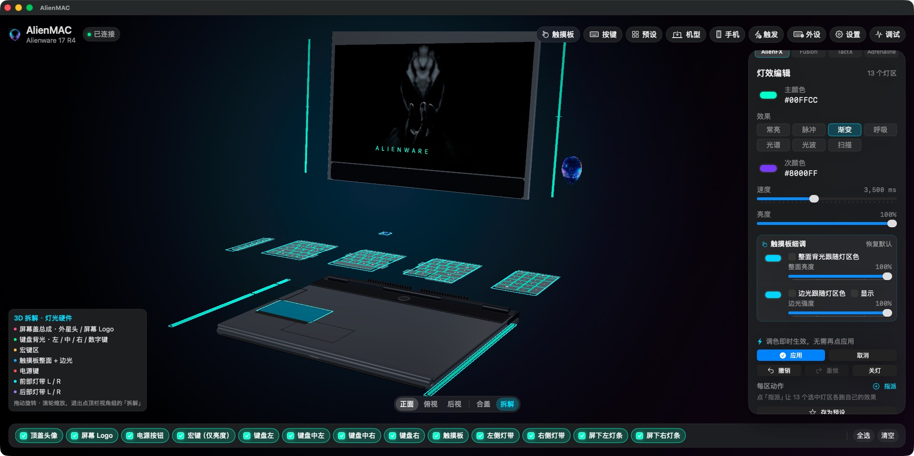
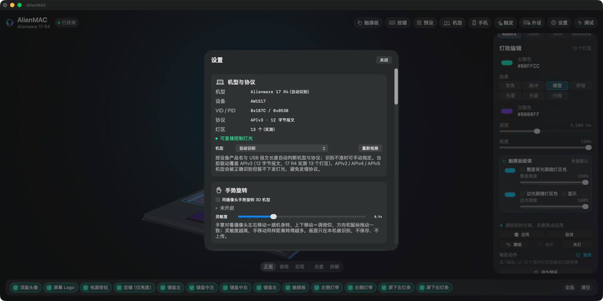

# AlienMAC

**在 macOS 上控制 Alienware 17 R4 的 AlienFX 灯效。** 纯用户态 IOKit HID 实现，不需要 kext、不用关 SIP，为黑苹果环境打磨。

[](https://github.com/RockJesus/AlienMAC/releases)
[](https://github.com/RockJesus/AlienMAC)
[](LICENSE)


## 能做什么

- **13 个灯区独立控制**：顶盖头像、屏幕 Logo、电源按钮、宏键、键盘四区、触摸板、左右侧灯带、屏下左右灯条，可单选或多选
- **七种灯效**：常亮、脉冲、渐变、呼吸，外加光谱、光波、扫描三种逐帧灯效，速度与亮度可调
- **配色即时生效**：调色不必再点「应用」，改动直接下发并自动保存
- **23 套现成主题**：10 套常用配色 + 13 套 AWCC 官方预置；也能把当前配色存成自己的预设
- **3D 实机模型**：按 424 × 332 × 30 mm 真实尺寸参数化建模，直接在发光的立体位置上点选灯区，可旋转、缩放、合盖
- **拆解视图**：屏幕盖、键盘四区、宏键、触摸板、电源键、前后灯带分层抬起，一眼看清每个发光部件的装配位置
- **单键映射**：95 个按键逐个上色，3D 键盘同步预览；硬件仍是四区背光，下发时取该键所在分区的主色
- **触摸板细调**：整面背光与四薄条边光分开控制，各自可跟随灯区色或单独指定颜色
- **网页控制（手机版 / 桌面版）**：同一 Wi-Fi 下扫码开手机版，电脑浏览器打开是桌面控制台，机身建模与 app 实时同步，不用装 App
- **接入 Home Assistant**：MQTT Discovery 自动生成带 RGB / 亮度 / 灯效的灯实体，双向同步
- **语音与 Siri**：说「关闭键盘灯」「亮一点」即可；内置四个 App Intent，可用「嘿 Siri」调用
- **手势旋转**：摄像头识别手掌左右 / 上下移动转动机身，画面只在本机推理
- **菜单栏常驻**：快捷颜色、我的预设、亮度滑杆、开关灯；`⌥⌘L` 全局开关灯，`⌥⌘↑↓` 调亮度
- **登录自启与状态恢复**：开机自动接管灯光，启动后还原上次配置
- **外设与诊断**：内置 AWCC 全量设备库（225 条授权设备 / 11 款元数据 / 343 条官方灯区），插上鼠标键盘即按 VID/PID 认出型号、灯区数与协议；鼠标族（0x5A）可直接试发单色与恢复默认；一只鼠标常暴露 3 个 HID 接口，面板按 VID/PID 合成一行并写明会落到哪个接口——AW558 实测灯控在「消费控制接口 0x0C/0x01 的 64 字节 output」，不是鼠标主接口，而它只声明 64B 输入、输出长度读到 0，所以按声明长度当门槛会挡掉唯一能用的通道；现在改成按声明排序、逐个试写：打不开的接口（0001/xx 在未授权「输入监控」时一律被拒）自动跳过、继续试下一个，写灯本身不需要「输入监控」授权；结果里写明实际落到的接口与「返回码不可信，以肉眼确认灯是否变化」，失败时给出无符号错误码（如 0xE00002E2）和一句中文解释，宏键可捕获、别名与 JSON 导出；**调试台**可全量扫描本机 HID 接口、只读自检（读 Feature + 发只读 query 收回应）判定协议族，并把结论存成设备档案，导出 JSON 分享给同型号用户导入；插拔外设会自动重扫，鼠标 0x5A 与键盘 v8 可导出「参考帧」文本（含 reportID、长度与逐字节 hex），方便对照和反馈；「诊断」把自检回读与参考帧合成一份可直接贴 issue 的文本（不含用户名/路径/序列号）；「提针导出/导入」把自检结论变成可分享的 JSON，别人导入后能按同一 VID/PID 比对结论；档案里存了灯区/效果/颜色的已验证设备，插上后会按「档案自动落位」开关自动选回去。标「6.x 待补」的型号只有名称与 VID/PID，灯区与按键元数据在 AWCC 6.x 安装包内，暂未提取；提取出结果后点「导入 6.x」即可接上（只认 alienmac.awcc6/1 结构，读不出来就不采纳）。设备库里的「机型库」是 AWCC 设备库 v3：29 款具名机型 / 1954 条灯区 / 365 条逐键 LED 索引，按 VID:PID 反查本机型号，逐键那栏点一个键就能看它占用哪几颗 LED（社区实测数据，非官方；表里没有的控制器会直说没有，不拿相近 PID 顶上）。机型库右上角可「导出 JSON」（单机型完整字段，可再读回）或「复制灯区表」（TSV，直接贴进表格）；逐键那栏会先给一行体检：索引区间、占用多少颗、几处被多个键共用、区间里空了几个位置。协议胶囊下面写明「12 表行」的原始机型名与对照依据（如 11 表把 x15R2/x17R2 合成一行），没有依据的行宁可留空。逐键键名可多选，「导出选区」出一份 `alienmac.keyleds/1` 清单（机型、选中的键、去重后的 LED 索引、被多键共用的索引），这是给后续帧编码用的原料，不是帧、也不会触发发送；「导入对照」读 `alienmac.aliases/1` 文件（自带 Tron/键盘/风扇值），只补内置表还没对上的机型、绝不覆盖已有行，补进来的会标「外部对照，未验证」并染成橙色。选中键后还会按 v4「03 23」选灯命令试排一组帧（每帧 5 字节头 + 最多 28 个 LightID、固定 33 字节），显示帧数与首帧 hex 并可复制——这只是在面板里生成的预览，不发硬件，索引直接当 LightID 这点没在真机上验证过。「对照模板」把 12 表里还没对上的协议行导成 `alienmac.aliases/1`（协议值带出来、targets 留空），填好机型名再导入即可生效；鼠标行的「巡回」可按序列（四色 / 双色 / 自定义十六进制）、间隔（0.6–5 s）与轮次（1–9）配置，自定义写法 `FF0000,00A0FF:蓝` 与 `青:00D2FF` 都认，写坏会退回四色而不是不发；回执改成带时间戳的最近 5 条、可一键整段复制；首次成功的接口连「接口签名」一起记进偏好，下次点色先试它，插拔后接口表变了签名对不上就自动作废（面板里也有「忘掉」按钮）；其它外设（键盘 / 显示器）多了「HID 通道探测」，只枚举接口并尝试打开、不写任何字节，接上新设备时先看清哪个接口放行。
- **触发器**：按「某个应用切到前台 / 插拔电源 / 锁屏解锁 / 每日定时」自动切换配色，可逐条启停、立即测试

## 截图

| 拆解视图 | 预设主题 |
|---|---|
|  |  |



## 安装

**DMG（推荐）**：下载 [Releases](https://github.com/RockJesus/AlienMAC/releases) 里的 `AlienMAC-x.y.z.dmg`，把 app 拖进「应用程序」。包内 app 已做 ad-hoc 签名，首次打开被 Gatekeeper 拦住时，右键 → 打开即可；如果提示的是「已损坏，无法打开」（图标带禁用标），说明文件被浏览器加了隔离属性，执行：

```bash
xattr -dr com.apple.quarantine /Applications/AlienMAC.app
```

2.3.0 之前的包因为编译后又追加了 80 端口转发器，签名封条失效，才会出现「已损坏」，现在的包在打包最后一步重签并校验过。

**从源码编译**：

```bash
brew install xcodegen
git clone https://github.com/RockJesus/AlienMAC.git
cd AlienMAC
./build.sh        # 编译 Release
./create_dmg.sh   # 编译并打包 DMG
```

产物在 `build/Build/Products/Release/AlienMAC.app`；开发时 `open AlienMAC.xcodeproj` 后 Cmd+R。签名用 Ad-hoc，无需开发者账号。**请把 app 放进 `/Applications`**：`SMAppService` 只在已签名且位于应用程序目录时才能登记登录项。

## 构建（不需要 Xcode）

只装 Command Line Tools 就能出包，不依赖 Xcode、xcodegen、xcodebuild：

```bash
scripts/build-clt.sh          # 编译 → 组包 → 签名 → dmg/zip，产物在 build/
scripts/build-clt.sh --no-dmg  # 只要 .app
scripts/selfcheck.sh          # 纯逻辑自检（通道排序、错误码、鼠标帧形状）
```

`./build.sh` 检测到没有 Xcode 时会自动转到这条路径。有 Xcode 时两条路产物一致：`build.sh` 走 xcodebuild，`build-clt.sh` 走 swiftc。

## 使用

### 3D 视图操作

| 操作 | 效果 |
|---|---|
| 左键拖动 | 绕机身旋转，上下拖动调俯仰，鼠标变抓手 |
| 滚轮 / 双指 | 缩放 |
| 点击灯区 | 选中 / 取消，支持多选；未选中任何灯区时调色作用于全部 |
| 底部视角组 | 正面 / 俯视 / 后视｜合盖 / 拆解，点击平滑过渡 |
| 拆解态 | 左侧出现硬件图例，可继续切正面 / 俯视 / 后视，再点「拆解」复位 |
| 点击屏幕画面 | 用系统浏览器打开作者博客 |

### 灯光与预设

底栏 13 个胶囊对应 13 个灯区，点一下选中、点第二下取消，「全选 / 清空」一键批量。右侧面板选主色、效果（渐变 / 呼吸会多出次色与速度）、亮度，改动即时下发。调好后点「存为预设」命名保存，之后在「预设」面板或菜单栏里一键切回。右键预设可删除。自定义预设可整包导出成 JSON（面板里的「导出预设」），在另一台机器用「导入预设」还原；重名会自动加「（导入）」后缀，不会覆盖原有预设。

导出的 JSON 带 `schema`（当前为 1）、`appVersion`、`exportedAt` 和当前版本的完整灯区表（`zones`，13 项，含 id 与名称）。导入时会做三项校验并提示：文件 `schema` 高于本机时按兼容模式导入；灯区表与当前版本不一致时列出差异项；预设里出现未知灯区位时只按现有灯区导入，不会丢整条预设。旧版本导出的、没有 `schema` 字段的文件按 1 处理，可以直接导入。

### 网页控制（手机版 / 桌面版）

点顶部「手机」弹出面板，手机和这台 Mac 连同一个路由器，扫二维码即可打开网页版（机身建模与 app 实时同步）。地址用的是本机 Bonjour 主机名，形如 `http://你的主机名.local:8899`。

同一个地址按访问设备自动分派：手机上打开是竖排单列的手机版，电脑浏览器打开是左边大机身预览、右边控制台的桌面版。两版共用同一套接口，点哪边都会立刻下发到机身。

网页里的面板就是 app「灯效编辑」这一栏的搬版：主颜色、效果（常亮 / 脉冲 / 渐变 / 呼吸 / 光谱 / 光波 / 扫描）、亮度、触摸板细调（整面背光与边光分开跟色、各自亮度）、每区动作（选中灯区后「＋ 指派」让它跑自己的效果，可切循环 / 单次）、应用与取消、撤销 / 重做、快捷主题、存为预设。标题和机型也跟 app 顶上一致。

想指定用哪一版，直接在地址后面加 `/mobile` 或 `/desktop`。手机版页面底部也留了「在电脑上打开桌面版」的入口。

两版里的「机身预览」都是 app 这块 3D 视图的实时截图：角度、配色、屏幕壁纸、背景辉光都和主界面一致，改灯效会立刻反映过来。

不想输端口号：在面板里点「启用」，输一次管理员密码，之后手机直接访问 `http://你的主机名.local` 就能打开（80 端口由系统守护进程转到 app 的网页服务）。随时点「停用」还原，恢复带端口的地址。

### 快捷键

| 快捷键 | 动作 |
|---|---|
| `⌥⌘L` | 灯光开 / 关 |
| `⌥⌘↑` | 亮度 +10% |
| `⌥⌘↓` | 亮度 −10% |

### 配置文件

设置保存在 `~/Library/Application Support/AlienMAC/settings.json`（亮度、上次灯光、自定义预设、启动行为），删掉即可恢复默认。诊断导出在 `diagnostics/` 目录。

## 机型与协议

| 协议 | 报文 | 覆盖机型 | 本 App |
|---|---|---|---|
| APIv2 | 9 字节 / 4-bit 色 | 13 R2、15 R2、M11x 等 | 识别，暂不控制 |
| APIv3 | 12 字节 / 8-bit 色 | 17 R4、17 R5、15 R3/R4 等 | **可控制** |
| APIv4 | 34 字节（AW-ELC）/ 33 字节 SET_REPORT | m15/m17、x15/x17、Area-51m、Aurora R10+、G5/G7 | 可下发（未在实机验收） |
| APIv5 | 64 字节 Feature | 逐键 RGB 键盘机型 | 识别，暂不控制 |
| APIv6 / v7 | 65 字节 Feature | 65 字节机型（VID 区分） | 识别，暂不控制 |
| APIv8 | 65 字节 Feature，A5 灯块 | 新一代逐键机型 | 可下发（未在实机验收） |

协议判定同时看报文长度和 VID：只有 65 字节还不够，`0x04F2` 才是 v8，Alienware 本体的 65 字节按 v6 处理，`0x0461` 是 v7。

机型按设备产品字符串（17 R4 为 `AW1517`）与 HID 输出报文长度判断，不硬编码 PID。当前机型、VID/PID、协议、灯区数与是否可控都在「设置 → 机型与协议」里，识别不准可手动指定后重新检测。

**17 R4 实测**：`0x187C / 0x0530`，APIv3 12 字节报文，Report ID `0x02`，13 个灯区（宏键与电源键只有亮度/开关，颜色帧覆盖其余 11 个彩色灯区，所以「逐灯测试」是 11 步）。

### v4 / v8 实机试发

「设置 → 机型与协议」面板里，v4 和 v8 的卡片带橙色「实机未验收」徽标——发送路径已接好，但没在对应硬件上跑过。试发前先看清楚：

- 面板顶部是「允许向 v4/v8 实机下发」总开关（默认开）和「帧间隔」选择（4 / 8 / 16 ms）。关掉开关后，任何 v4/v8 场景都不会发出去，只写一条 `scene blocked` 日志。
- 卡片上的「最小试发 1 盏灯」只发一盏橙色常亮灯，不改其它灯区。协议不匹配时直接跳过并说明，例如在 17 R4（v3）上点 v8 试发，会提示「当前机型是 APIv3，不是 APIv8，已跳过」。
- 亮度滑杆对 v4/v8 生效：v4 走压暗量 `03 26`（0 最亮、`0x64` 全灭），v8 走 `17` 亮度字节（0–`0x0A`）。
- 每次下发都会重发一次失败的帧，结束后给出「下发 N/N 帧（重发 M 次）· 成功率 X% · 用时 T ms」。每帧的返回码、耗时和报文前 8 字节会写进 `~/Library/Application Support/AlienMAC/diagnostics/hid-tx-日期.log`，出问题先看这个文件。

## 黑苹果前置检查

AlienFX 控制器挂在主板内部 USB 总线上，先确认端口已驱动：

```bash
system_profiler SPUSBDataType | grep -A 5 -i alien
ioreg -p IOUSB -l | grep -i 187c
```

看不到设备时，用 [USBMap](https://github.com/corpnewt/USBMap) 或 [USBToolBox](https://github.com/USBToolBox/tool) 重新定制 USB 端口，确保 AlienFX 所在的内部 USB 2.0 端口（通常 HSxx）已启用。

## 故障排除

**显示未检测到控制器** — 先跑上面的 USB 检查，确认系统报告里有 VID `0x187C` 的设备，再点「重新扫描」。

**连上了但灯没反应** — 点「重置控制器」，看调试日志有没有 TX 行。APIv3 控制器短时间收太多请求会假死，完全断电（关机拔电源 10 秒）可恢复。

**某个灯区控制了错误的灯** — 用「逐灯测试」记录实际 bit，再改 `Sources/Models/AlienFXTypes.swift` 里 `LightZone` 的位定义。

**登录自启开关点不动** — 确认 app 已放进 `/Applications` 且为签名构建；仍失败时设置页会显示原因，可点「打开登录项设置」手动添加。

**MQTT 一直连不上** — 应用会给出具体原因（端口拒绝、认证失败等）并在 6 秒后重试；先确认 broker 端口对外开放、账号密码正确。

## 更多文档

`Docs/` 下有协议与灯区资料：`awcc-wire-protocol.md`（报文格式）、`awcc-catalog.md`（AWCC 主题与灯区表）、`ath-format.md`（.ath 主题文件结构）、`lamp-zones/`（灯区素材）。

## 参考

- [T-Troll/alienfx-tools](https://github.com/T-Troll/alienfx-tools) — AlienFX 协议逆向
- [OpenRGB Alienware 文档](https://gitlab.com/OpenRGBDevelopers/OpenRGB-Wiki/-/blob/stable/Device-Documentation/Alienware-AlienFX.md)
- [trackmastersteve/alienfx](https://github.com/trackmastersteve/alienfx) — Linux 实现

## 许可证

MIT，详见 [LICENSE](LICENSE)。
