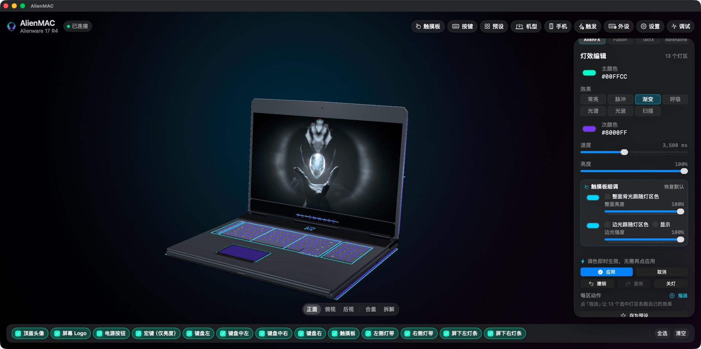
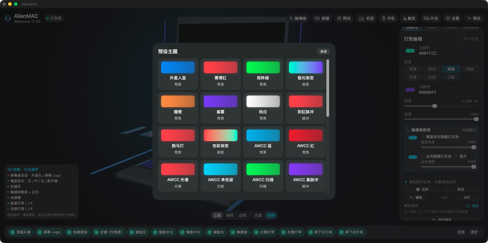

# AlienMAC

**在 macOS 上控制 Alienware 17 R4 的 AlienFX 灯效。** 纯用户态 IOKit HID 实现，不需要 kext、不用关 SIP，为黑苹果环境打磨。

[](https://github.com/RockJesus/AlienMAC/releases)
[](https://github.com/RockJesus/AlienMAC)
[](LICENSE)



## 能做什么

- **13 个灯区独立控制**：顶盖头像、屏幕 Logo、电源按钮、宏键、键盘四区、触摸板、左右侧灯带、屏下左右灯条，可单选或多选
- **七种灯效**：常亮、脉冲、渐变、呼吸，外加光谱、光波、扫描三种逐帧灯效，速度与亮度可调
- **配色即时生效**：调色不必再点「应用」，改动直接下发并自动保存
- **23 套现成主题**：10 套常用配色 + 13 套 AWCC 官方预置；也能把当前配色存成自己的预设
- **3D 实机模型**：按 424 × 332 × 30 mm 真实尺寸参数化建模，直接在发光的立体位置上点选灯区，可旋转、缩放、合盖
- **拆解视图**：屏幕盖、键盘四区、宏键、触摸板、电源键、前后灯带分层抬起，一眼看清每个发光部件的装配位置
- **单键映射**：95 个按键逐个上色，3D 键盘同步预览；硬件仍是四区背光，下发时取该键所在分区的主色
- **触摸板细调**：整面背光与四薄条边光分开控制，各自可跟随灯区色或单独指定颜色
- **手机网页控制**：同一 Wi-Fi 下扫码打开网页，机身建模与 app 实时同步，不用装 App
- **接入 Home Assistant**：MQTT Discovery 自动生成带 RGB / 亮度 / 灯效的灯实体，双向同步
- **语音与 Siri**：说「关闭键盘灯」「亮一点」即可；内置四个 App Intent，可用「嘿 Siri」调用
- **手势旋转**：摄像头识别手掌左右 / 上下移动转动机身，画面只在本机推理
- **菜单栏常驻**：快捷颜色、我的预设、亮度滑杆、开关灯；`⌥⌘L` 全局开关灯，`⌥⌘↑↓` 调亮度
- **登录自启与状态恢复**：开机自动接管灯光，启动后还原上次配置
- **外设与诊断**：列出 Dell / Alienware HID 设备与协议归属，支持宏键捕获、别名与 JSON 导出
- **触发器**：按「某个应用切到前台 / 插拔电源 / 锁屏解锁 / 每日定时」自动切换配色，可逐条启停、立即测试

## 截图

| 拆解视图 | 预设主题 |
|---|---|
|  |  |


## 安装

**DMG（推荐）**：下载 [Releases](https://github.com/RockJesus/AlienMAC/releases) 里的 `AlienMAC-x.y.z.dmg`，把 app 拖进「应用程序」。首次打开被 Gatekeeper 拦住时，右键 → 打开，或执行：

```bash
xattr -dr com.apple.quarantine /Applications/AlienMAC.app
```

**从源码编译**：

```bash
brew install xcodegen
git clone https://github.com/RockJesus/AlienMAC.git
cd AlienMAC
./build.sh        # 编译 Release
./create_dmg.sh   # 编译并打包 DMG
```

产物在 `build/Build/Products/Release/AlienMAC.app`；开发时 `open AlienMAC.xcodeproj` 后 Cmd+R。签名用 Ad-hoc，无需开发者账号。**请把 app 放进 `/Applications`**：`SMAppService` 只在已签名且位于应用程序目录时才能登记登录项。

## 使用

### 3D 视图操作

| 操作 | 效果 |
|---|---|
| 左键拖动 | 绕机身旋转，上下拖动调俯仰，鼠标变抓手 |
| 滚轮 / 双指 | 缩放 |
| 点击灯区 | 选中 / 取消，支持多选；未选中任何灯区时调色作用于全部 |
| 底部视角组 | 正面 / 俯视 / 后视｜合盖 / 拆解，点击平滑过渡 |
| 拆解态 | 左侧出现硬件图例，可继续切正面 / 俯视 / 后视，再点「拆解」复位 |
| 点击屏幕画面 | 用系统浏览器打开作者博客 |

### 灯光与预设

底栏 13 个胶囊对应 13 个灯区，点一下选中、点第二下取消，「全选 / 清空」一键批量。右侧面板选主色、效果（渐变 / 呼吸会多出次色与速度）、亮度，改动即时下发。调好后点「存为预设」命名保存，之后在「预设」面板或菜单栏里一键切回。右键预设可删除。

### 快捷键

| 快捷键 | 动作 |
|---|---|
| `⌥⌘L` | 灯光开 / 关 |
| `⌥⌘↑` | 亮度 +10% |
| `⌥⌘↓` | 亮度 −10% |

### 配置文件

设置保存在 `~/Library/Application Support/AlienMAC/settings.json`（亮度、上次灯光、自定义预设、启动行为），删掉即可恢复默认。诊断导出在 `diagnostics/` 目录。

## 机型与协议

| 协议 | 报文 | 覆盖机型 | 本 App |
|---|---|---|---|
| APIv2 | 9 字节 / 4-bit 色 | 13 R2、15 R2、M11x 等 | 识别，暂不控制 |
| APIv3 | 12 字节 / 8-bit 色 | 17 R4、17 R5、15 R3/R4 等 | **可控制** |
| APIv4 | 34 字节（AW-ELC） | m15/m17、x15/x17、Area-51m、Aurora R10+、G5/G7 | 识别，暂不控制 |
| APIv5 | 64 字节 Feature | 逐键 RGB 键盘机型 | 识别，暂不控制 |

机型按设备产品字符串（17 R4 为 `AW1517`）与 HID 输出报文长度判断，不硬编码 PID。当前机型、VID/PID、协议、灯区数与是否可控都在「设置 → 机型与协议」里，识别不准可手动指定后重新检测。

**17 R4 实测**：`0x187C / 0x0530`，APIv3 12 字节报文，Report ID `0x02`，13 个灯区（宏键与电源键只有亮度/开关，颜色帧覆盖其余 11 个彩色灯区，所以「逐灯测试」是 11 步）。

## 黑苹果前置检查

AlienFX 控制器挂在主板内部 USB 总线上，先确认端口已驱动：

```bash
system_profiler SPUSBDataType | grep -A 5 -i alien
ioreg -p IOUSB -l | grep -i 187c
```

看不到设备时，用 [USBMap](https://github.com/corpnewt/USBMap) 或 [USBToolBox](https://github.com/USBToolBox/tool) 重新定制 USB 端口，确保 AlienFX 所在的内部 USB 2.0 端口（通常 HSxx）已启用。

## 故障排除

**显示未检测到控制器** — 先跑上面的 USB 检查，确认系统报告里有 VID `0x187C` 的设备，再点「重新扫描」。

**连上了但灯没反应** — 点「重置控制器」，看调试日志有没有 TX 行。APIv3 控制器短时间收太多请求会假死，完全断电（关机拔电源 10 秒）可恢复。

**某个灯区控制了错误的灯** — 用「逐灯测试」记录实际 bit，再改 `Sources/Models/AlienFXTypes.swift` 里 `LightZone` 的位定义。

**登录自启开关点不动** — 确认 app 已放进 `/Applications` 且为签名构建；仍失败时设置页会显示原因，可点「打开登录项设置」手动添加。

**MQTT 一直连不上** — 应用会给出具体原因（端口拒绝、认证失败等）并在 6 秒后重试；先确认 broker 端口对外开放、账号密码正确。

## 更多文档

`Docs/` 下有协议与灯区资料：`awcc-wire-protocol.md`（报文格式）、`awcc-catalog.md`（AWCC 主题与灯区表）、`ath-format.md`（.ath 主题文件结构）、`lamp-zones/`（灯区素材）。

## 参考

- [T-Troll/alienfx-tools](https://github.com/T-Troll/alienfx-tools) — AlienFX 协议逆向
- [OpenRGB Alienware 文档](https://gitlab.com/OpenRGBDevelopers/OpenRGB-Wiki/-/blob/stable/Device-Documentation/Alienware-AlienFX.md)
- [trackmastersteve/alienfx](https://github.com/trackmastersteve/alienfx) — Linux 实现

## 许可证

MIT，详见 [LICENSE](LICENSE)。
